# Акт VI. Хорай: город тысячи фонарей

Дизайн-документ арки: мир, сюжет, персонажи, боевая система и план релиза. Что уже есть в игре, помечено **[в игре]**; что запланировано — **[план]**.

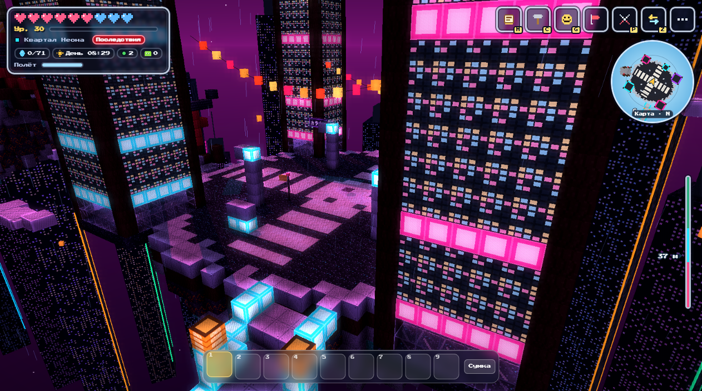

**Видео боя:** [video/horai_fight.mp4](video/horai_fight.mp4). 23 секунды из игры: засада, клинч, серия Мурамасой, идеальное уклонение, Иссэн, падение на сохэя, вторая волна, цепь молний Райкири, гром Они-муся.

---

## 1. Суть арки в одном абзаце

Герой убил богов. Об этом узнал весь мир. Божественный ихор пролился на землю людей, и люди поняли главное: **одного смертного хватило, чтобы свергнуть Олимп**. Начинается эпоха Сэнгоку Небес. Кланы, ордена и корпорации летающего города Хорай охотятся за той же силой. Они достали записи боёв героя и выучили его приёмы. Хорай — первое место в игре, где против тебя дерутся *не монстры, а люди, которые дерутся как ты*. Под городом спят драконы японских легенд, и кто-то очень хочет их разбудить.

**Опорная идея арки:** «Твоя сила вернулась к тебе отражением». Каждый враг — искажённое зеркало одного из стилей героя. Каждое оружие, добытое в Хорае, даёт герою стиль этого врага.

---

## 2. Лор

### 2.1. Последствия

- **Ихоропад.** Когда пали Зевс и Кронос, ихор богов дождём упал на мир людей. Там, где он лёг, люди стали сильнее: быстрее, живучее, злее.
- **Записи.** Бои героя видели все. Зеркальные камни из Небесного свода разошлись по рынкам, и в Хорае их крутят в додзё, как учебные фильмы.
- **Охота за силой.** Если один человек смог, смогут и другие. Кланы делят город и ищут то, что сильнее ихора: спящих драконов.

### 2.2. Хорай

Хорай (по-китайски Пэнлай) — мифический остров бессмертных, где китайская и японская легенды сходятся в одну. В нашей версии это летающий мегаполис над морем облаков. Внизу видны неоновые небоскрёбы мира людей, наверху — пагоды, тории и нефритовый дворец. Над городом идёт вечный дождь, висит красная луна, а за горизонтом медленно плывёт дракон.

### 2.3. Фракции

| Фракция | Кто это | Что хотят | Враги в игре |
|---|---|---|---|
| **Клинки Пепла** | Ронины и синоби, выпившие ихор. Учатся по записям боёв героя. | Доказать, что могут повторить подвиг героя. | Ронин Пепла, Кагэ-синоби |
| **Орден Курама** | Вороньи тэнгу с горы Курама. По легенде они учили фехтованию Минамото-но Ёсицунэ. | Вернуть порядок, в котором люди не трогают небо. | Карасу-тэнгу |
| **Сёгунат Они** | Демоны в доспехах, стражи печатей под дворцом. | Не дать никому разбудить драконов. Или разбудить их самим. | Они-муся (элита) |
| **Сэйрю-кай** [план] | Корпорация Лазурного дракона. Владеет неоновым кварталом. | Разбудить Ороти и надеть его силу. | Кицунэ-оммёдзи, сохэй |

### 2.4. Главный антагонист [план]

**Кагэмару, Тень героя.** Первый, кто полностью выучил стиль героя по записям. Носит доспех, перекрашенный в цвета героя, и дерётся его приёмами: рывок, комбо из трёх ударов, Иссэн. Появляется три раза: на крыше Квартала Неона, у пагоды и в финале под дворцом, где пытается сломать печать Ороти.

---

## 3. Карта Хорая

Город устроен вертикально, как и вся игра: снизу вверх. Три яруса, девять районов, мосты и тропы между ними. Вокруг города ходит монорельс, между небоскрёбами летают аэромобили.

| Ярус | Район | Высота | Что там | Засада |
|---|---|---|---|---|
| 17 | **Облачная гавань** | 20 | Деревянные пирсы, джонки с красными парусами, торий-портал обратно к богам, флажок | нет |
| 17 | **Рынок фонарей** | 22 | Улица лавок с неоновыми навесами, гирлянды бумажных фонарей, раменная | Ронины и синоби |
| 17 | **Улица Гион** | 27 | Старый город: двухэтажные дома-матия с сёдзи, таверна и чайная, большие красные ворота | Ронин, фонари-обакэ, кицунэ |
| 17 | **Онсэн** | 30 | Горячие источники в пару, баня, бамбуковый забор, снежные обезьяны в воде | Сохэи и тэнгу |
| 18 | **Квартал Неона** | 36 | Скрамбл-перекрёсток, башни с окнами и кандзи, переход по крышам, рекламный экран «神を斬った男» («Человек, убивший богов») | Синоби, ронины и тэнгу |
| 18 | **Небесная башня** | 36–82 | Вертикальный ориентир города: 46 этажей, неоновые карнизы каждые восемь этажей, золотой шпиль | нет |
| 18 | **Додзё Клинков** | 44 | Открытый зал, ринг, соломенные мишени, барабан тайко. Сэнсэй запускает испытание из четырёх волн | по запросу |
| 18 | **Тропа тысячи ториев** | 36–46 | Подъём под красными воротами | нет |
| 18 | **Сакуровая роща** | 46 | Сакуры, бамбук, пруд с мостиком, каменные фонари | Тэнгу |
| 18 | **Пагода пяти ярусов** | 50 | Пагода с загнутыми карнизами, бронзовый колокол (завязка Киёхимэ) | [план] |
| 19 | **Нефритовый дворец** | 60 | Лунные ворота, террасы, колонны с нефритовыми драконами, двойная золотая крыша | Они-муся с охраной |

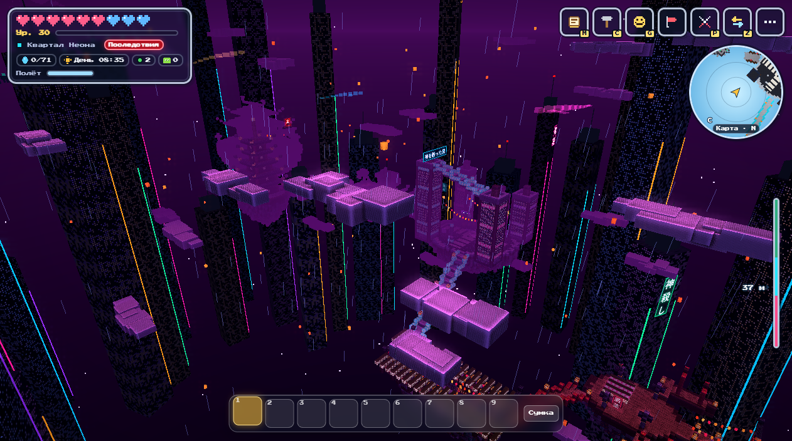
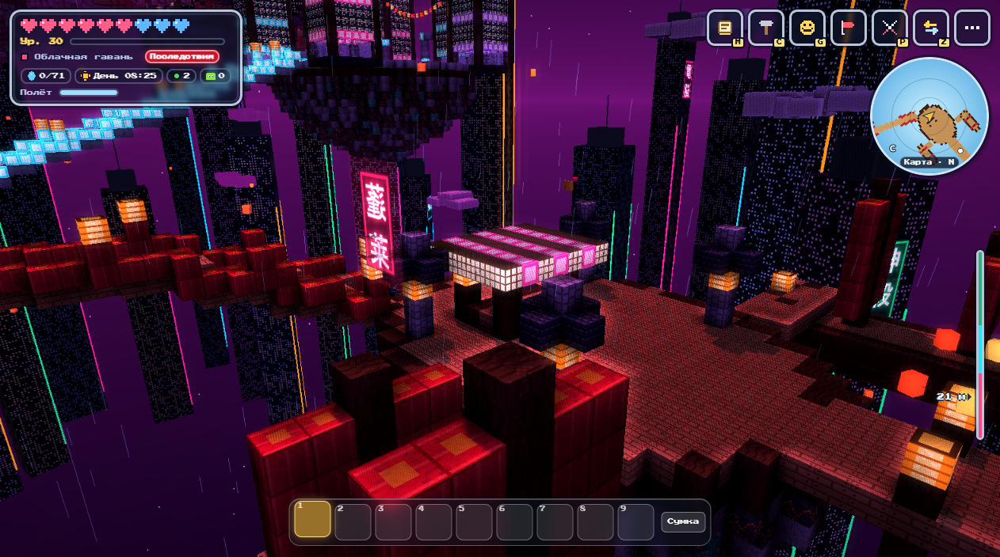
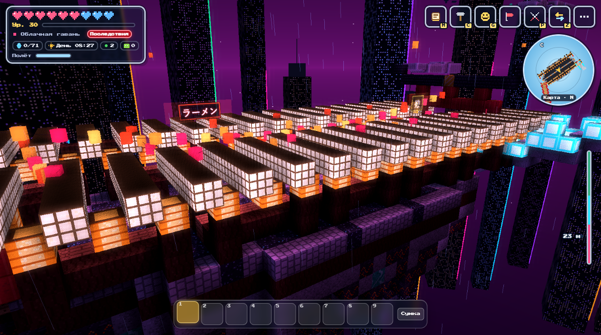
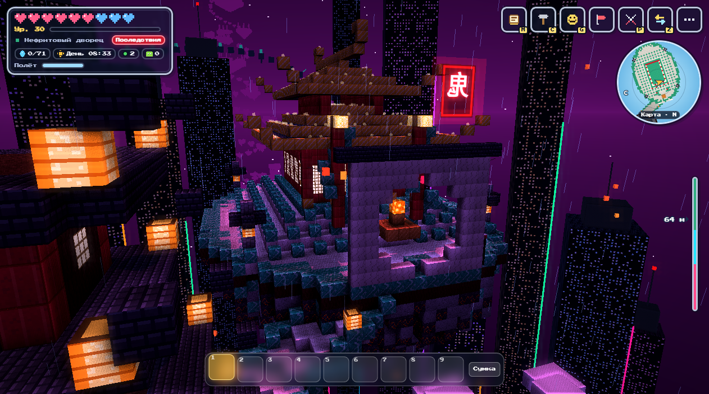

**Атмосфера [в игре]:** вечная ночь, фиолетово-розовая дымка, дождь, 40+ небоскрёбов-силуэтов в облаках, неоновые вывески с мерцанием, фальшивые отражения неона на мокром асфальте, небесные фонарики, голографические карпы над городом, дракон на горизонте, красная луна.

**Жизнь города [в игре]:** прохожие под зонтиками-вагаса ходят по улицам и разбегаются, когда начинается бой; коты на улицах убегают от героя; снежные обезьяны сидят в онсэне; живой голо-экран крутит рекламу «Человека, убившего богов»; над городом идёт монорельс.

**Новые блоки [в игре]:** красный лак, тёмная черепица, неон трёх цветов, бумажный фонарь, нефрит, мокрый асфальт, сёдзи, бамбук, тёмное дерево, окна небоскрёбов.

---

## 4. Персонажи

Принцип дизайна: **читаемый силуэт с первого взгляда и одна яркая деталь-подпись**. У каждого врага своя форма, свой цвет и свой «звук» атаки.

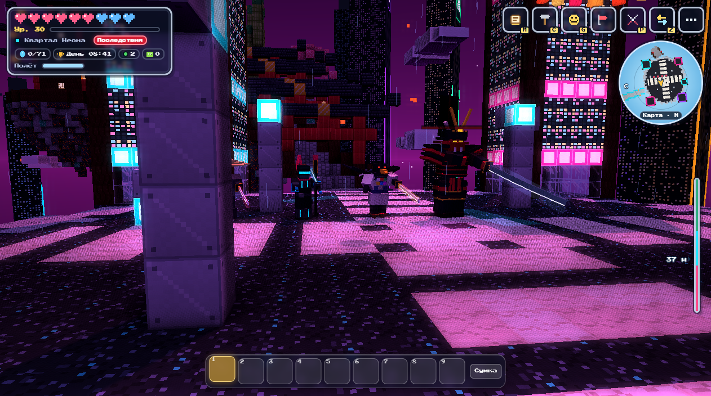

### 4.1. Ронин Пепла [в игре]

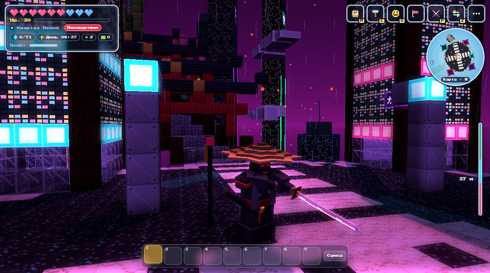

- **Силуэт:** широкая соломенная каса (восьмиугольная, с обломанным краем), под ней тень и два красных глаза.
- **Детали:** пепельное хаори с рваным подолом, красный пояс-оби, хакама в складку, наплечник с красной шнуровкой, менпо (железная полумаска) с красной прорезью, хвост волос, ножны у бедра.
- **Оружие:** проклятая катана с красным свечением. Изогнутое лезвие, белый хамон, золотая цуба.
- **Стиль:** «зеркало обычного комбо героя».
  - **Комбо из трёх ударов:** кэса-гири сверху наискосок, обратный восходящий удар, укол с выпадом.
  - **Иай (居合):** прячет клинок, приседает, вспыхивает красная звезда. Ронин пролетает сквозь героя, а разрез догоняет через мгновение.
  - **Стойка:** блокирует удары спереди. Удар по стойке ломает её постуру (жёлтая полоска), сломанная стойка открывает его.
  - **Контратака** после удачного блока.
- **Дроп:** пепельная сталь, печать ронина.

### 4.2. Кагэ-синоби [в игре]

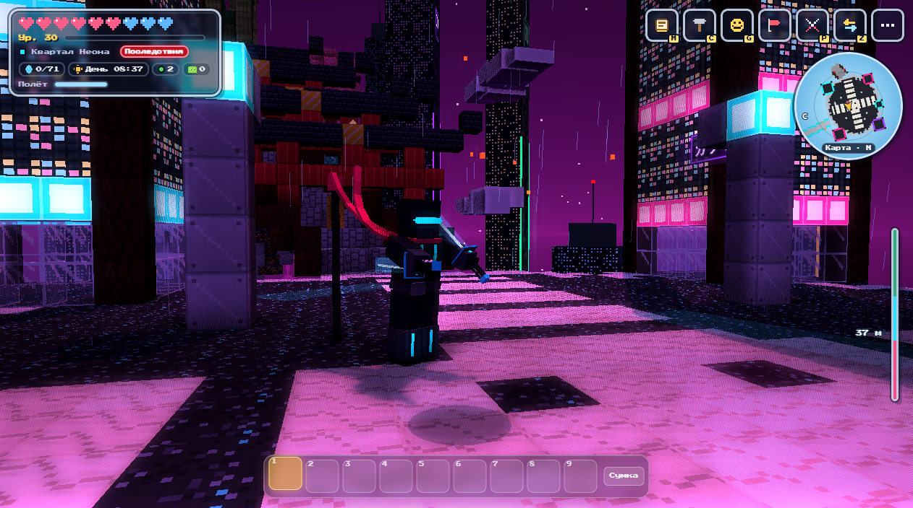

- **Силуэт:** тонкий, чёрный, с длинным красным шарфом в два хвоста, которые живут своей жизнью.
- **Детали:** стелс-броня с бирюзовыми неоновыми линиями, светящийся визор поперёк глаз, капюшон, наручи, щитки на голенях.
- **Оружие:** два кодати обратным хватом с бирюзовой кромкой. Кунаи.
- **Стиль:** «зеркало рывка героя».
  - **Рывок и крест (X-cut)** двумя клинками.
  - **Тень (影):** исчезает в дыму и появляется у героя за спиной.
  - **Веер кунаев:** три ножа. Кунаи можно **отбить** мечом обратно в синоби.
  - Часто уклоняется сальто назад.
- **Дроп:** пепельная сталь, чип тени.

### 4.3. Карасу-тэнгу [в игре]

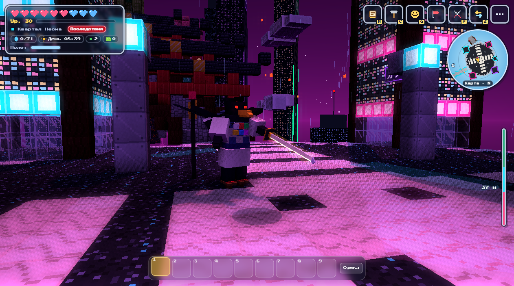

- **Силуэт:** воронья голова с длинным оранжевым клювом, огромные чёрные крылья.
- **Детали:** одежда ямабуси в клетку, **шесть помпонов-бонтэн** на груди (белый, красный, зелёный, жёлтый, синий, розовый), чёрная шапочка-токин, гэта на одном зубе, перьевой воротник.
- **Оружие:** прямой меч-цуруги и перьевой веер-хаутива.
- **Стиль:** «зеркало полёта героя». Летает над ареной.
  - **Пике (天):** поднимается, вспыхивает и падает на героя по прямой. После приземления пару секунд беззащитен.
  - **Ветер (風):** взмах веера, три режущих серпа ветра, они отталкивают. Отбиваются мечом.
  - Комбо мечом, когда стоит на земле.
- **Дроп:** пепельная сталь, перо тэнгу.

### 4.4. Они-муся, страж дворца (элита) [в игре]

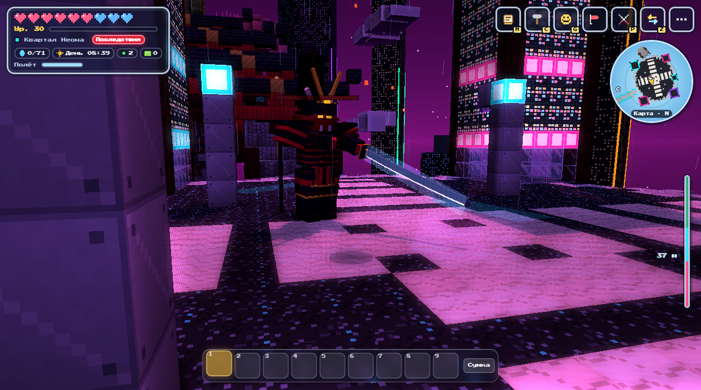

- **Силуэт:** в полтора раза выше всех, золотые рога-кувагата на шлеме и флаг-сасимоно за спиной.
- **Детали:** о-ёрой из чёрных лакированных пластин с красной шнуровкой, огромные наплечники-содэ, юбка из пяти пластин, красная маска демона с клыками и жёлтыми глазами, собственные костяные рога, флаг «鬼» («демон»).
- **Оружие:** нодати Райкири длиной больше роста героя, с электрической кромкой.
- **Стиль:** «зеркало тяжёлого оружия героя».
  - **Раскол:** удар сверху, ударная волна, молния. Нельзя скрестить клинки, нужно уходить рывком.
  - **Широкий взмах** туда и обратно.
  - **Гром (雷):** три молниеносных шага вокруг героя, на каждом удар и молния с неба. Финал — прыжок и удар о землю с волной.
  - **Микири (見切):** на половине здоровья встаёт в стойку. Ударишь лёгким ударом — он прочтёт удар, телепортируется за спину и разрубит. Тяжёлый удар стойку пробивает.
  - **Ярость** ниже 50% здоровья: быстрее, вокруг бегают молнии.
  - Своя полоса здоровья и постуры наверху экрана.
- **Дроп:** Райкири (первое убийство гарантированно), рог они, много стали.

### 4.5. Кицунэ-оммёдзи [в игре]

- **Силуэт:** высокая чёрная шапка-эбоси, белая лисья маска с красными штрихами и золотыми глазами, три хвоста с огненными кончиками.
- **Детали:** белый каригину с широкими рукавами, фиолетовые хакама, талисманы-офуда в руке, голубой лисий огонь в другой.
- **Стиль:** маг, держит дистанцию.
  - **Лисий огонь (狐火):** пять огоньков кружат вокруг и летят в героя, доворачивая на лету.
  - **Печать (封):** круг под ногами героя, через секунду взрывается столбом огня. Уходи рывком.
  - **Иллюзия (幻):** двое двойников, которые исчезают от одного удара в листве. Настоящая кицунэ телепортируется.
  - Вместо уклонения исчезает в листьях.
- **Дроп:** лисий огонь.

### 4.6. Сохэй [в игре]

- **Силуэт:** крупный монах в белой повязке-капюшоне, длинная нагината.
- **Детали:** чёрное кромо, шафрановая кэса через плечо, огромные чётки с красной бусиной, высокие гэта.
- **Стиль:** танк с длинным оружием.
  - **Вихрь (旋):** крутит нагинату и идёт на героя, бьёт каждые 0,35 секунды.
  - **Длинный укол** на 5 блоков.
  - **Подсечка:** низкий взмах, его можно перепрыгнуть.
  - **Талисман (札):** бросает офуду, герой на 2 секунды скован и замедлен.
  - Держит стойку, контратакует после блока.
- **Дроп:** чётки сохэя.

### 4.7. Тётин-обакэ [в игре]

- **Силуэт:** бумажный фонарь с одним огромным глазом и длинным языком.
- **Стиль:** ёкай-камикадзе, приходят стайкой. Раздувается и светится (爆), потом летит в героя и взрывается.
- **Дроп:** бумага васи.

### 4.8. В плане [план]

| Персонаж | Фольклор | Роль | Подпись |
|---|---|---|---|
| **Кагэмару** | — | Соперник | Цвета героя, его же приёмы, три дуэли за арку |
| **Каса-обакэ** | Ёкай-зонтик | Прыгун | Прыгает на одной ноге, язык-хлыст |
| **Нурэ-онна** | Морская змея-женщина | Засада у гавани | Выныривает из облаков, хватает хвостом |
| **Каппа-контрабандист** | Каппа | Торговец | Обменивает сталь и перья на нектары и фрагменты |

### 4.9. Жители Хорая [в игре]

| NPC | Где | Что даёт |
|---|---|---|
| **Тэцуо, повар рамэна** | Рынок | Рамэн раз в 2 минуты: полное здоровье и броня, +1 к удару на 3 минуты |
| **Юки, мико** | Сакуровая роща | Омикудзи раз в 3 минуты: 大吉 (сила и скорость), 吉 (лечение) или 凶 (засада!). Задание: 5 кицунэ |
| **Старый Масамунэ** | Гавань | Задание: 8 пепельной стали → 2 печати ронина для Мурамасы |
| **Нэко, информатор** | Квартал Неона | Лор про записи боёв. Задание: 6 синоби |
| **Дзэнко, монах** | Пагода | Легенда Киёхимэ. Задание: 8 фонарей-обакэ |
| **Сэнсэй Кодзиро** | Додзё | Испытание: четыре волны, последняя — Они-муся |
| **Окми-сан** | Онсэн | Отдых: полное здоровье и быстрый бег на 3 минуты |

---

## 5. Драконы: боссы арки (Киёхимэ и Рюдзин — в игре, Ороти — план)

Главные боссы — драконы японских легенд. Каждый — отдельная механика, а не «больше здоровья».

### 5.1. Киёхимэ, невеста-змея (босс пагоды)

**Легенда (Додзё-дзи):** девушка влюбилась в монаха, он сбежал и спрятался под храмовым колоколом. Она от ярости превратилась в огненную змею, обвила колокол и расплавила его вместе с монахом.

**Бой:**
- Арена — двор пагоды с огромным бронзовым колоколом.
- **Фаза 1, девушка:** призрачная танцовщица в белом кимоно, веер, огненные серпы. Хоррор-подача: голос, плач, мигающий свет.
- **Фаза 2, змея:** кольца обвивают колокол. Герой может спрятаться под колоколом от огненного дыхания, но колокол раскаляется: 3 секунды внутри безопасно, дальше горит.
- **Фаза 3:** колокол падает и становится оружием: если ударить по нему, звон оглушает змею, и её можно рубить.

**Дроп:** «Колокол Додзё-дзи» (аксессуар: звон оглушает врагов рядом раз в 30 секунд), огненный шарф.

### 5.2. Рюдзин, царь драконов моря (босс гавани)

**Легенда:** морской дракон-бог, живёт во дворце Рюгу-дзё. Хранит две жемчужины, Канджу и Мандзю: одна поднимает прилив, другая опускает.

**Бой:**
- **Прилив и отлив:** Рюдзин бросает жемчужину. Вода поднимается и затапливает нижние пирсы, Рюдзин плывёт сквозь облачное море. Потом отлив обнажает дно и ракушечные платформы.
- Герой ловит момент отлива, чтобы добраться до головы.
- **Механика «украсть жемчужину»:** если отбить брошенную жемчужину катаной, прилив работает против дракона.

**Дроп:** «Жемчужина приливов» (активный предмет: замедляет всех вокруг, как вода), чешуя Рюдзина.

### 5.3. Ямата-но Ороти, восьмиглавый змей (финал арки)

**Легенда (Кодзики):** восемь голов, восемь хвостов, тело длиной в восемь долин. Сусаноо поставил восемь чанов сакэ, головы напились, и он их отрубил. В хвосте змея нашёлся меч **Кусанаги-но Цуруги**, одна из трёх императорских регалий Японии.

**Бой (рейд под дворцом, для кооператива):**
- Восемь голов, у каждой стихия: огонь, лёд, яд, молния, тьма, ветер, вода, камень.
- **Механика сакэ:** на арене восемь бочек. Голову, которую ты отвлёк к бочке, можно «напоить», и она засыпает на 10 секунд. Двое игроков успевают положить больше голов.
- Отрубленная голова отрастает, если не прижечь шею огнём (Длани Геракла или огненная руна).
- Финал: Кагэмару пытается взять силу Ороти и сам становится девятой головой.

**Дроп:** **Кусанаги-но Цуруги** — меч, который режет ветром. Удар выпускает серп ветра, который косит всё на линии. Особый приём «Сусаноо» — буря вокруг героя.

---

## 6. Боевая система: аниме-бой

Главное изменение арки. Цель — чтобы бой выглядел как в аниме и в клипе-референсе: удары с длинными шлейфами, кадры удара, разрезы, которые догоняют, вспышки, дым и обломки.

### 6.1. Принципы

1. **Враги дерутся как герой.** У врагов есть стойка, рывок, комбо, кадры удара и восстановление. Они не просто бегут на героя.
2. **Каждое действие читается.** Перед атакой всегда есть телеграф: вспышка на клинке (белая — можно скрестить, красная — нельзя) и кандзи над головой.
3. **Окно наказания.** После сильной атаки враг открыт. Ронин после иая вкладывает меч в ножны, тэнгу после пике сидит на земле.
4. **Никакой толпы.** Атаковать одновременно могут не больше двух обычных врагов, остальные кружат и ждут (система жетонов).

### 6.2. Механики [в игре]

| Механика | Как работает | Что видит игрок |
|---|---|---|
| **Скрещивание клинков** | Если ударить в момент удара врага, клинки сталкиваются: оба отлетают, враг оглушён | Вспышка-звезда, искры, звон, остановка кадра, негатив на два кадра, надпись «КЛИНКИ СКРЕСТИЛИСЬ!» |
| **Идеальное уклонение** | Рывок (Shift) в момент удара врага включает замедление времени для врагов на 1,7 секунды | Мир теряет цвет, фиолетовая виньетка, остаточный силуэт героя |
| **Постура** | Блоки и удары копят жёлтую полоску. Полная — стойка сломана, враг открыт и получает ×1,7 урона | Кандзи 隙 («брешь»), негатив-кадр |
| **Отражение снарядов** | Взмах клинком отбивает кунаи и ветер обратно во врага | «ОТБИТО!», искры |
| **Разрубание** | Убийство клинком разрезает врага по поясу: верх улетает, низ падает, обе половины сгорают тушью | Линия разреза, брызги чёрной туши |
| **Кадры удара** | Сильные удары на два кадра инвертируют экран, потом дают жёсткий чёрно-белый кадр | Как в аниме |
| **Засады** | Каждый район атакует при входе: две волны, потом отдых 2,5 минуты | Огромный кандзи 斬 и «ЗАСАДА» на экране |

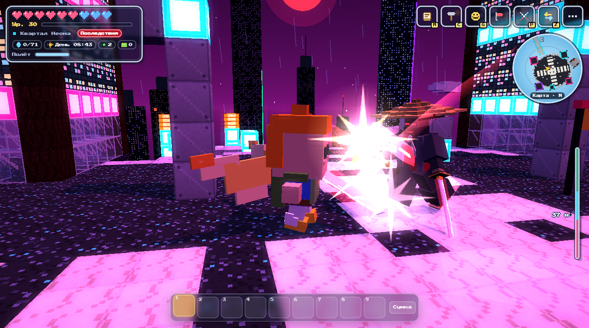
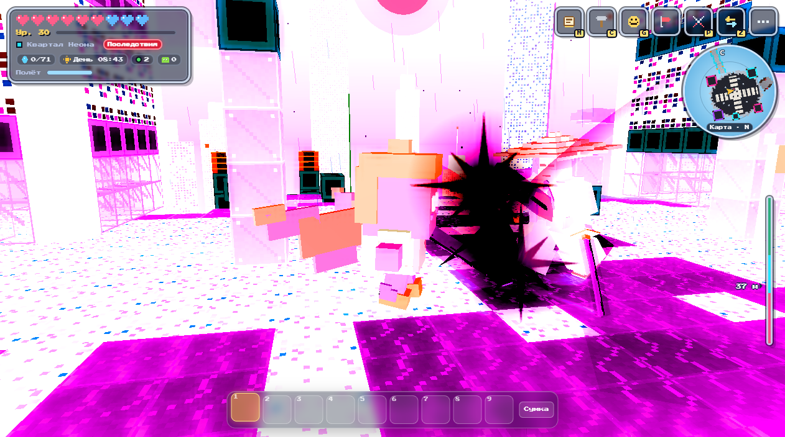
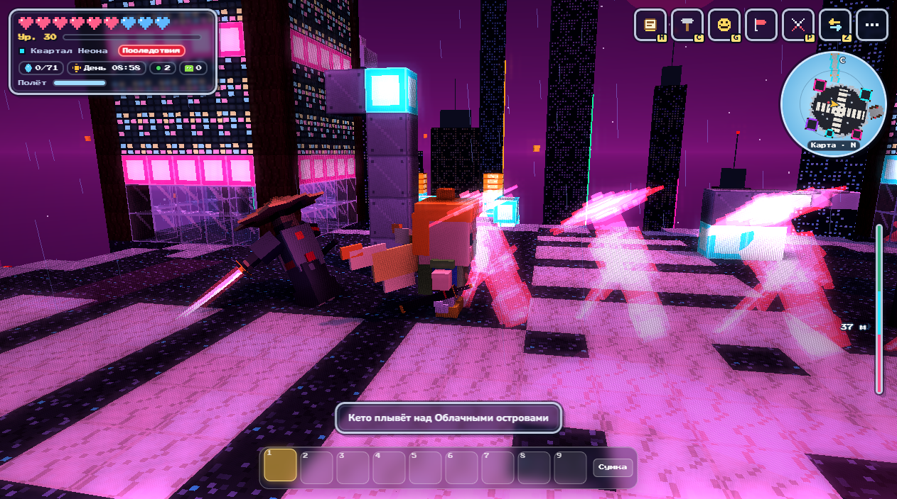
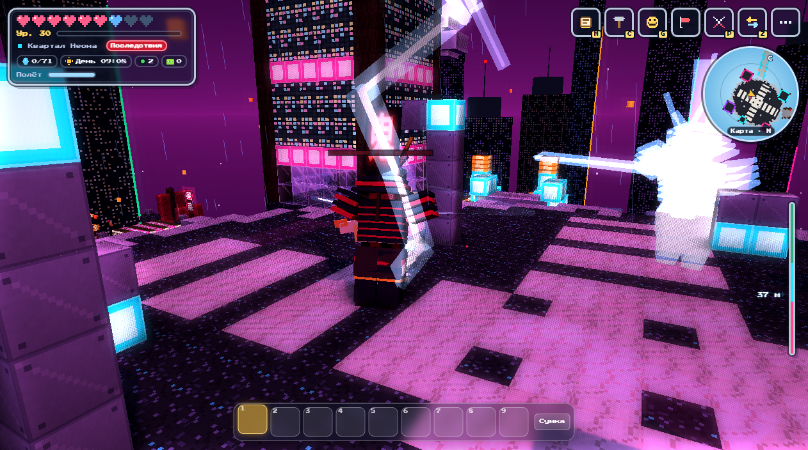
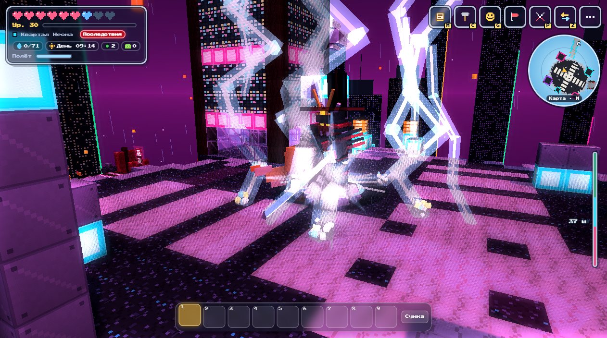
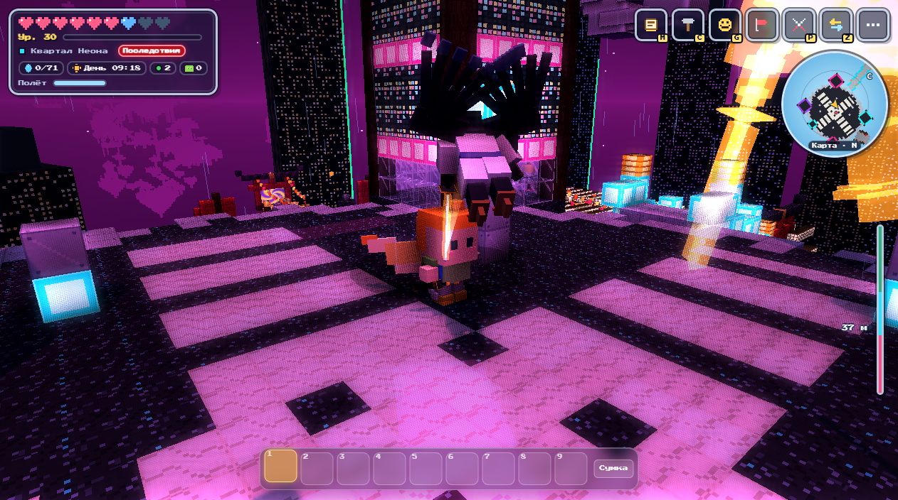
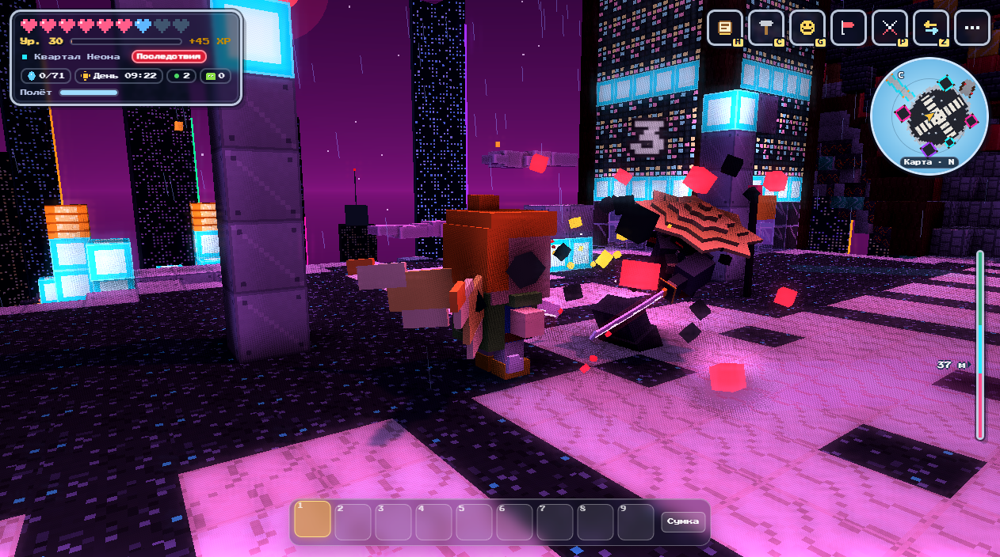

### 6.3. Набор эффектов [в игре]

- **Шлейфы клинков:** настоящая лента за кромкой меча, сглаженная сплайном, горячая у острия и тающая у основания.
- **Удар как в клипе-референсе:** звёздная вспышка, радиальные линии скорости, кубические обломки с отскоком, мультяшный дым из гранёных клубов, тёмный кратер, кольцо.
- **Остаточные силуэты:** при рывках, телепортах и падениях.
- **Линии разреза:** белая полоса прорезает цель, за ней цветной ореол.
- **Кандзи-телеграфы:** 居合, 影, 天, 風, 雷, 見切, 隙, 勝.

---

## 7. Оружие Хорая

Каждое оружие повторяет стиль врага, с которого падает. Так игрок буквально учится у противников.

### 7.1. Мурамаса, проклятая катана [в игре]

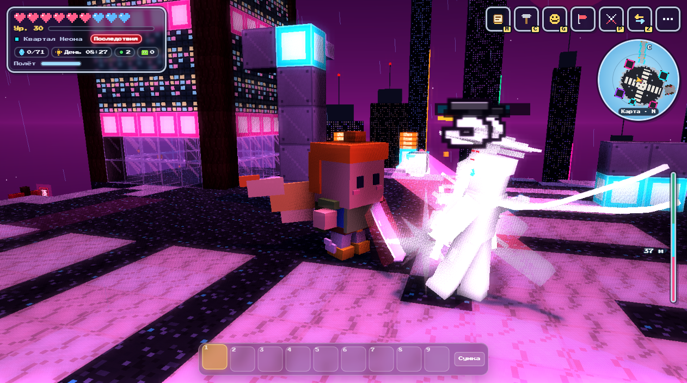

- **Откуда:** куётся в Хорае из 10 пепельной стали и 2 печатей ронина.
- **Серия:**
  1. Кэса-гири, наискосок сверху (3 урона).
  2. Обратный восходящий удар (3).
  3. Вихрь на 360° (3), подбрасывает врагов.
  4. **Иссэн (一閃):** герой исчезает и появляется за спинами врагов на линии до 12 блоков, сам доворачивает к ближайшей цели. Через мгновение, со звуком вкладываемого клинка, разрезы догоняют всех, мимо кого он пролетел (8 урона, ломает стойку).
- **В воздухе:** падающий клинок: пике вниз, кратер, обломки, дым, 5 урона вокруг.
- **Пассив:** отбивает снаряды.

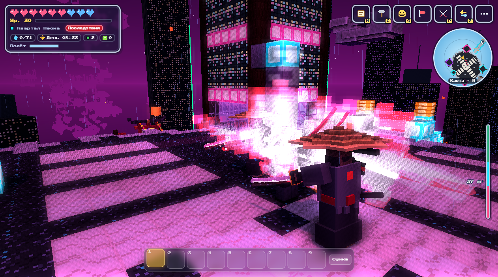
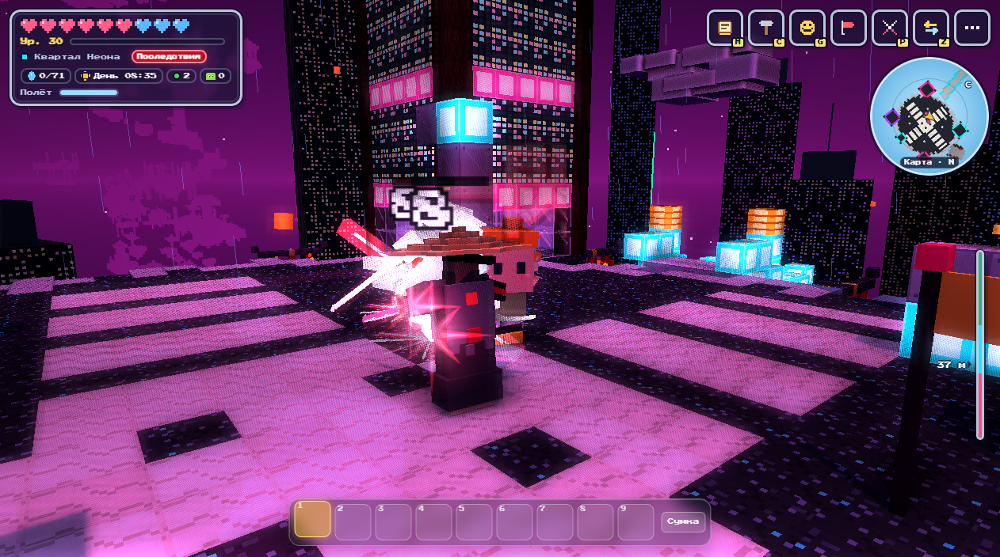
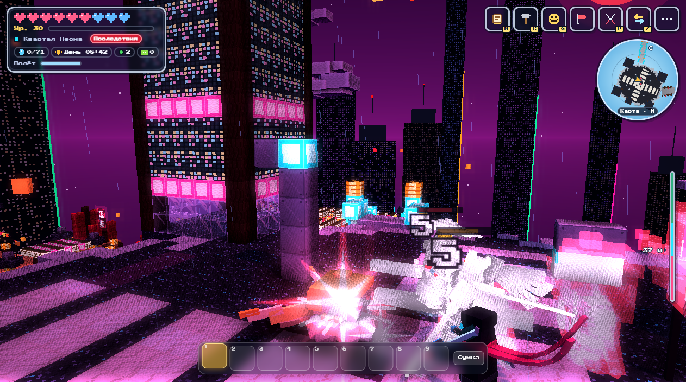

### 7.2. Райкири, «Режущий молнию» [в игре]

По легенде, Татибана Досэцу разрубил этим мечом молнию.

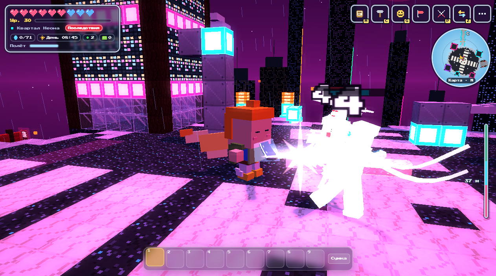

- **Откуда:** первое убийство Они-муся.
- **Серия:**
  1. Широкий взмах с разрядом (4).
  2. Обратный взмах (4).
  3. **Райдзин-сэн:** цепь рывков от врага к врагу, до шести целей. Герой появляется за каждым, рубит, и на цель бьёт молния с неба (6 урона, ломает стойку).
- **В воздухе:** громовое падение, четыре молнии вокруг кратера.

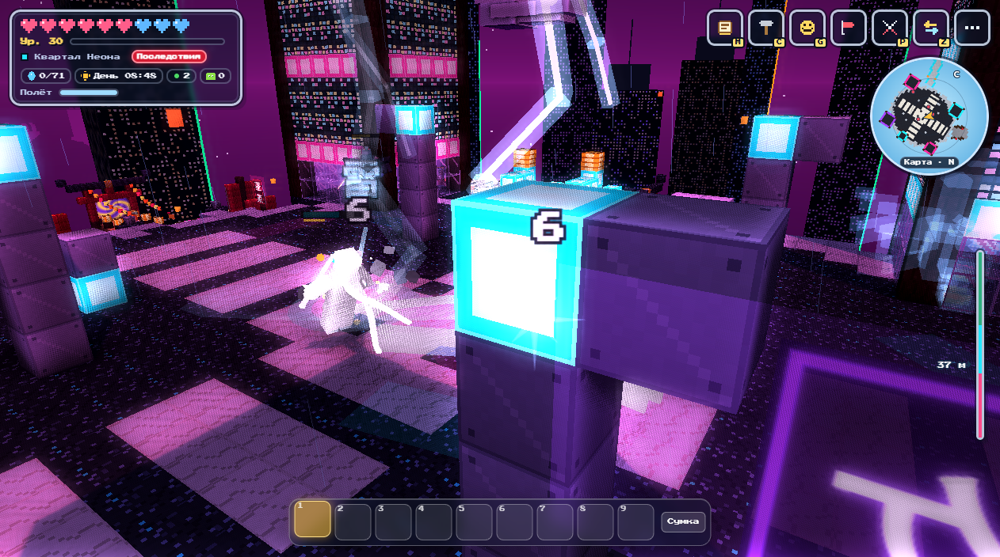

### 7.3. В плане [план]

| Оружие | Откуда | Стиль |
|---|---|---|
| **Кагэ-кодати** (парные) | Кагэмару | Рывок-тень за спину, X-удар, кунаи |
| **Хаутива тэнгу** (веер) | Тэнгу (крафт из перьев) | Порывы ветра, двойной прыжок на потоке |
| **Кусанаги-но Цуруги** | Ороти | Серпы ветра, буря «Сусаноо» |
| **Колокол Додзё-дзи** (аксессуар) | Киёхимэ | Звон оглушает врагов |
| **Жемчужина приливов** (активный предмет) | Рюдзин | Замедляющая волна |

---

## 8. Прогрессия и экономика

1. **Вход:** торий у стартового острова открывается после финала Небесного свода (любая концовка). Первый вход ставит флажок «Облачная гавань».
2. **Флажки:** Облачная гавань → Квартал Неона → Нефритовый дворец. Перелететь на неоткрытый ярус нельзя, работает тот же замок, что и в других мирах.
3. **Цикл:** засада в районе, сталь и материалы, Мурамаса, дворец, Они-муся, Райкири → [план] Киёхимэ, Рюдзин, Ороти.
4. **Материалы:** пепельная сталь (все), печать ронина, чип тени, перо тэнгу, рог они.
5. **Награды за районы:** первая зачистка района даёт 220 опыта и 6 стали, повторная — 90 опыта и 3 стали.

---

## 9. Кооператив [в игре]

- **Ведущий боя.** Засаду, дракона или дуэль ведёт тот, кто начал бой. Его игра решает ИИ и 10 раз в секунду рассылает снимок: позиции, состояние, здоровье, стойку, цель и номер атаки каждого врага.
- **Копии у напарников.** Напарник видит тех же врагов. Когда у врага начинается новая атака, копия у напарника проигрывает её сама, поэтому попадания по напарнику проверяются честно на его стороне.
- **Удары напарника** уходят ведущему и проходят через ту же проверку блока, стойки и микири, что и удары ведущего. Смерть врага рассылает ведущий, добыча и опыт достаются всем.
- **Цели.** Каждый враг выбирает игрока сам, с учётом того, сколько врагов уже атакуют этого игрока.
- **Передача боя.** Если ведущий ушёл, умер или отключился, бой продолжает игрок с наименьшим id среди тех, кто рядом. Копии становятся настоящими врагами.
- **Драконы** работают так же: ведущий рассылает состояние, цель и метки атак, урон по дракону общий, гонг и отбитую жемчужину напарника получает ведущий.
- **[план]** Совместные приёмы: два Иссэна крест-накрест.

---

## 10. Звук

- **[в игре]** Звон скрещённых клинков, свист разреза, щелчок клинка в ножнах после Иссэна, тайко при засаде, гром Райкири.
- **[план]** Свой музыкальный слой: сямисэн и кото поверх синтвейва, барабаны тайко в боях, на крышах дождь и далёкая реклама.

---

## 11. Технические заметки

- Город перестраивается при каждой загрузке и не пишется в сохранение карты. Около 60 тыс. видимых блоков: невидимые внутренние блоки теперь не рисуются вообще.
- Небоскрёбы, вывески, карпы, дракон, дождь и фонарики — меши, а не блоки. Они видны только в Хорае.
- Атлас блоков расширен с 48 до 85 типов.
- Шлейфы считаются аналитически по дуге удара, поэтому лента всегда идёт ровно за кромкой.

---

## 12. Дорожная карта

| Этап | Что входит | Статус |
|---|---|---|
| 6.0 | Город, четыре врага, засады, Мурамаса, Райкири, аниме-бой | **в игре** |
| 6.0.3 | Общий кооп Хорая, реванш боссов, PvP для новых приёмов, добивания, ранг стиля | **в игре** |
| 6.0.2 | Киёхимэ, Рюдзин, дуэли с Кагэмару, Кагэ-таби и бег по стенам, фото-режим с записью видео | **в игре** |
| 6.0.1 | Гион, онсэн, додзё, Небесная башня, монорельс, NPC и жители, кицунэ, сохэй, фонари-обакэ, живые анимации | **в игре** |
| 6.0.4 | Комбо с паузой (Цубамэ-гаэси, Сакура-ран, Райко, Каминари-гурума), отброс от ударов, отклик удара в PvP | **в игре** |
| 6.0.5 | Общие мобы во всех мирах: обычные мобы, разломы, арена, слуги боссов, Бездна; сложность растёт, когда игроков больше | **в игре** |
| 6.1 | Предупреждения перед сильными ударами, идеальное парирование, захват цели, совместные приёмы (два Иссэна крест-накрест) | план |
| 6.2 | Хаутива тэнгу, Кагэ-кодати, Колокол Додзё-дзи; Каса-обакэ, Нурэ-онна, Каппа-контрабандист | план |
| 6.3 | Ороти (рейд для кооператива), Кусанаги, финал арки | план |
| 6.4 | Дуэли PvP на крыше до 3 побед, испытания в додзё, музыка Хорая | план |
