# Hop to Olympus: полная документация проекта

Единый документ о том, что это за игра, как устроен продающий лендинг, какие механики и техники есть в игре, как всё запускать, обновлять и выкладывать. Скриншоты лежат в [docs/screens/landing](screens/landing), остальные материалы рядом: [LORE.md](LORE.md), [HOME_ISLAND.md](HOME_ISLAND.md), [WORKSHOP.md](WORKSHOP.md), [ARC_HORAI.md](ARC_HORAI.md), корневой [README.md](../README.md) и [CHANGELOG.md](../CHANGELOG.md).

## Оглавление

1. [Что это за проект](#1-что-это-за-проект)
2. [Карта репозитория](#2-карта-репозитория)
3. [Лендинг: архитектура](#3-лендинг-архитектура)
4. [Новый роадмап «Skyward Ascent»](#4-новый-роадмап-skyward-ascent)
5. [Новый раздел «Кто мы»](#5-новый-раздел-кто-мы)
6. [Механики игры](#6-механики-игры)
7. [Техники движения и боя](#7-техники-движения-и-боя)
8. [Режимы](#8-режимы)
9. [Миры и боссы](#9-миры-и-боссы)
10. [Кумо: питомцы, редкость, семья](#10-кумо-питомцы-редкость-семья)
11. [Кооп, PvP и сеть](#11-кооп-pvp-и-сеть)
12. [Мастерская и сообщество](#12-мастерская-и-сообщество)
13. [Управление](#13-управление)
14. [Запуск, деплой, проверка](#14-запуск-деплой-проверка)
15. [Как править контент](#15-как-править-контент)
16. [Принципы честности и тон текстов](#16-принципы-честности-и-тон-текстов)
17. [Что ещё впереди](#17-что-ещё-впереди)

---

## 1. Что это за проект

**Hop to Olympus** (рус. «Прыг на Олимп») — воксельная экшн-RPG и платформер, которая открывается в браузере по ссылке и работает на компьютере, планшете и телефоне. Игрок поднимается по небесным островам от Облачных островов к Олимпу, в Разлом Хаоса, под Звёздный купол, в Бездну Эреба и в неоновый город Хорай, сражается с богами и титанами, куёт снаряжение, строит свой остров и растит питомцев Кумо.

Что делает проект особенным:

- **Свой движок поверх Three.js.** Воксельный мир, свет, тени, облака и постобработка написаны командой. Конструкторов нет.
- **Игра как ритм.** Прыжки в такт ускоряют героя, паузы в комбо открывают спецприёмы, рывок даёт неуязвимость.
- **Кооп в браузере.** Два игрока на одном сервере видят одних и тех же мобов и боссов, лут и опыт общие, сеть честная: удары не теряются, бой не откатывается.
- **Честная редкость.** Шансы на сверхредкого Кумо публичны, номер сверхредкого уникален.
- **Альфа, которая растёт.** Состояние игры сейчас: альфа 5.4. Патч-ноты ведутся подробно и видны прямо на лендинге.

Репозиторий: `chevdev1/SKYBLOCK`, рабочая ветка `alpha-5.1-home-island`. Проект на Vercel называется `oblaka`.

## 2. Карта репозитория

```text
oblaka/
├─ index.html            основная версия лендинга (тёплое небо, 4 мира в карусели)
├─ action.html           экшен-версия лендинга (ночь, гроза, 6 миров, титан)
├─ landing/
│  ├─ app.js             ядро лендинга: 3D-сцена, камера по скроллу, i18n, рендер данных
│  ├─ studio.js          НОВОЕ: интерактивный роадмап и раздел «Кто мы»
│  ├─ studio.css         НОВОЕ: стили этих двух разделов
│  ├─ style.css          общие стили и дизайн-токены
│  ├─ voxel.js           воксельные модели, облака, герои
│  ├─ techview.js        3D-превью техник движения
│  ├─ arsenal.js         3D-превью оружия и брони
│  ├─ mapview.js         3D-карта мира
│  ├─ data/              весь контент в JSON (миры, механики, боссы, роадмап, патчи, ...)
│  ├─ img/ , video/      картинки, OG, скриншоты интерфейса, видео боя
│  └─ README.md          краткое описание лендинга
├─ play/index.html       сама игра (один файл, Three.js r128)
├─ server/server.js      сервер без зависимостей: таблицы, каталог карт, лайки
├─ docs/                 документация, лор, скриншоты, концепты
├─ vercel.json           редирект /play → /play/ и кэш статики
└─ .vercelignore         что не выкладывать (server/, docs/, логи)
```

## 3. Лендинг: архитектура

Лендинг — длинная прокручиваемая страница поверх **одной живой 3D-сцены**. Скролл ведёт камеру вниз: с рассвета над облаками сквозь облака к островам-мирам, мимо сцен с механиками к дому с Кумо и на закат с финальной кнопкой.

| Слой | Как устроен |
|---|---|
| Сцена | Three.js r128 (CDN), своя шейдерная небесная сфера, туман, пост-обработка (bloom) |
| Прокрутка | Lenis 1.1.13 для плавности, GSAP 3.12.5 и ScrollTrigger для появления блоков |
| Секции | у каждой `data-cam`: по нему камера знает, где «стоять» |
| Данные | `landing/data/*.json`, грузятся через `fetch`, поэтому нужен сервер, а не двойной клик по файлу |
| Языки | RU и EN. Статические строки в `data-i18n`, динамический контент берёт `[lang]` из JSON |
| Сборка | Нет. Всё статическое, выкладывается как есть |

Скриншоты основных секций:

| Первый экран | Падение сквозь облака |
|---|---|
| 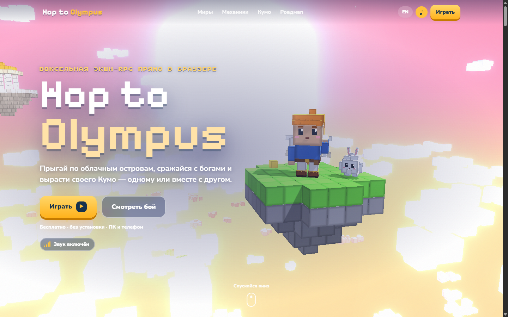 | 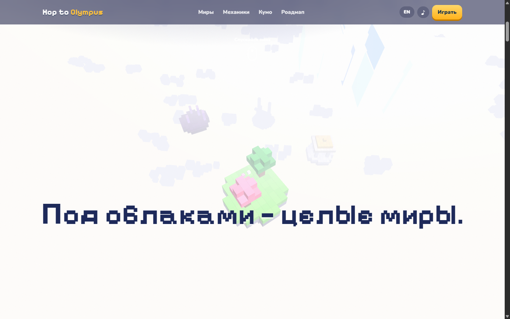 |

| Миры | Механики |
|---|---|
| 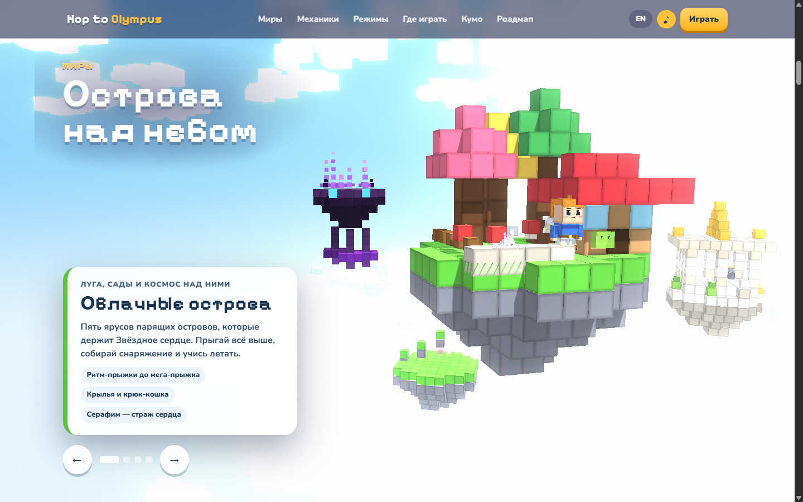 | 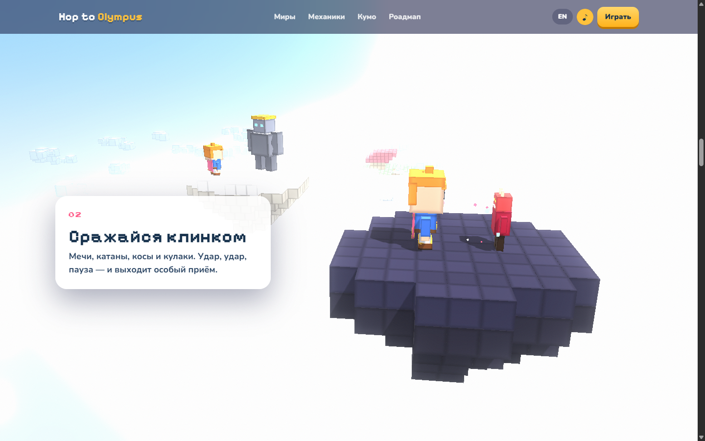 |

| Боссы | Кумо |
|---|---|
| 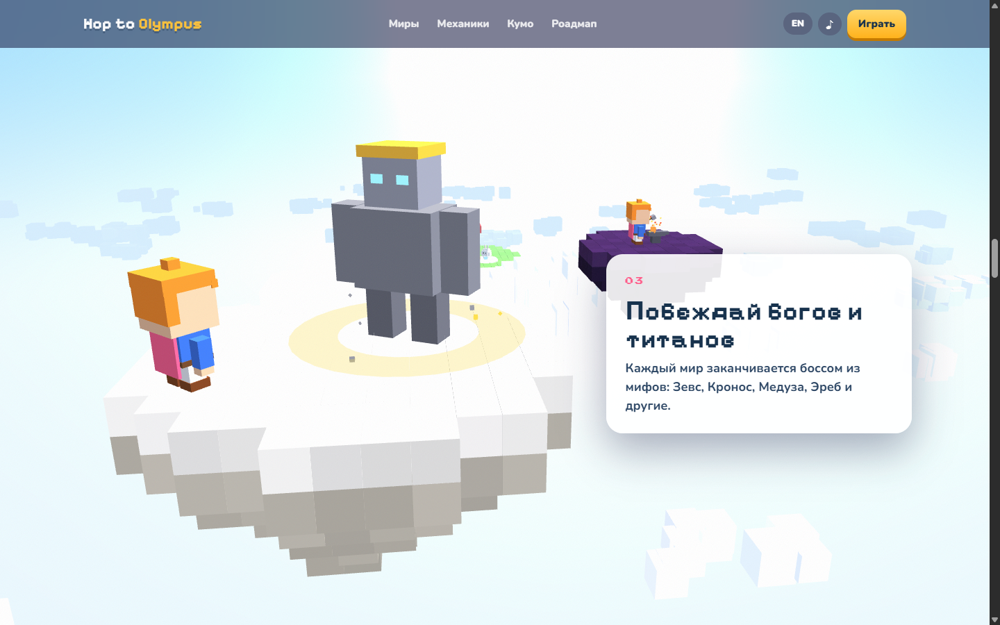 | 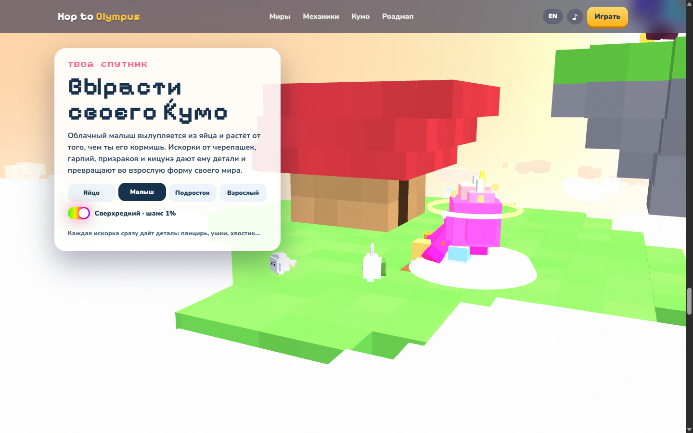 |

Две версии лендинга работают на одном `app.js`. Экшен-версия включается настройками `window.HTO_CFG` в `action.html`.

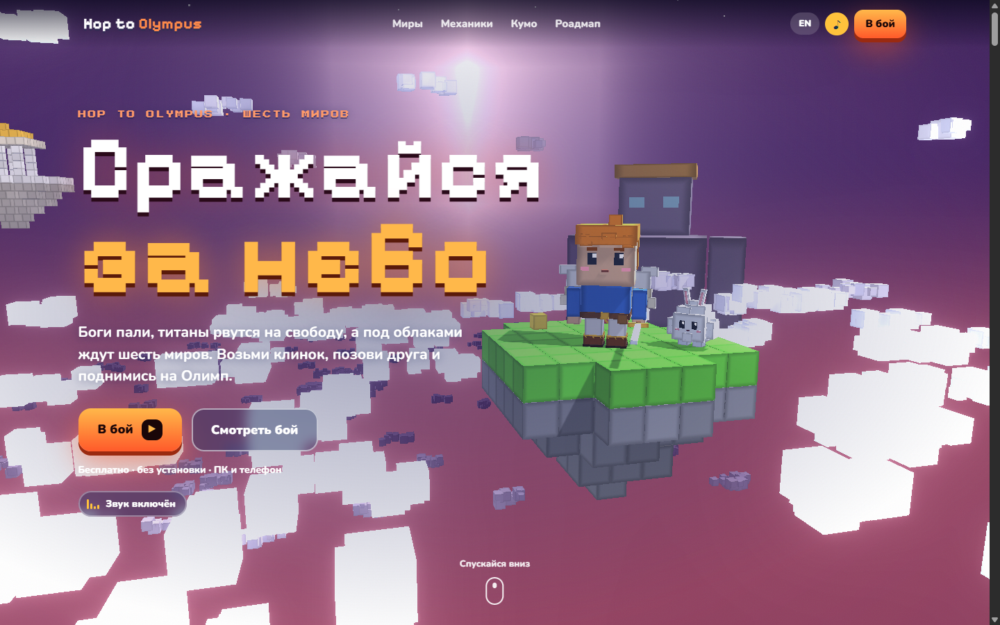

## 4. Новый роадмап «Skyward Ascent»

Старый роадмап был четырьмя плоскими колонками текста. Новый — интерактивная панель управления путём к релизу. Код в [landing/studio.js](../landing/studio.js), стили в [landing/studio.css](../landing/studio.css), данные в [landing/data/roadmap.json](../landing/data/roadmap.json).

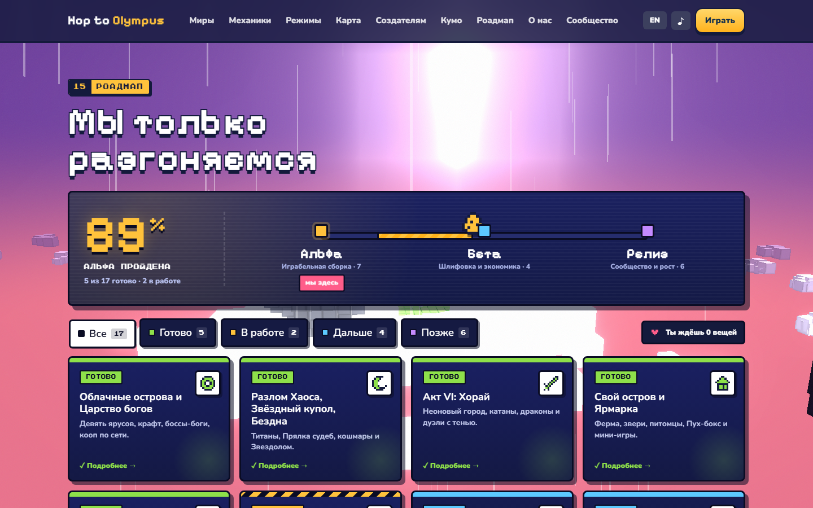

### Из чего состоит

1. **HUD восхождения.** Большой счётчик «Альфа пройдена» и трасса из трёх станций: Альфа, Бета, Релиз. Кумо-маркер прыгает по трассе и останавливается там, где проект находится сейчас. Процент считается из данных, а не рисуется вручную: готовый пункт даёт 100%, пункт «в работе» даёт своё `pct`.
2. **Станции кликабельны.** Нажатие на «Альфа» показывает готовое и текущее, на «Бета» — пункты «Дальше», на «Релиз» — «Позже». Повторное нажатие снимает фильтр.
3. **Фильтры-чипы.** Все, Готово, В работе, Дальше, Позже, с количеством. Активный чип «вдавливается» как физическая кнопка.
4. **Плитки-вехи.** У каждой пункта своя иконка в пиксель-арте, статусная полоса сверху, наклон за курсором в 3D, а у «В работе» бегущая заливка и полоса прогресса.
5. **Окно подробностей.** Клик по плитке открывает диалог: крупная иконка, направление, описание, что это значит для игрока, прогресс, стрелки к соседним вехам (также клавиши ← →), закрытие по Esc или клику мимо.
6. **«Жду это».** Игрок может отметить, чего ждёт. Выбор хранится в `localStorage` его браузера и нигде не отправляется. В шапке появляется счётчик «Ты ждёшь N вещей». Это интерактив без выдуманных чисел: никаких поддельных голосов.

| Окно вехи | Фильтр «Позже» |
|---|---|
| 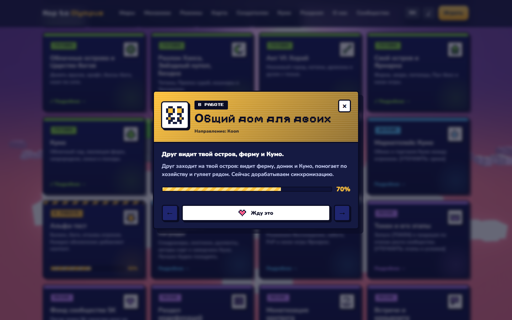 | 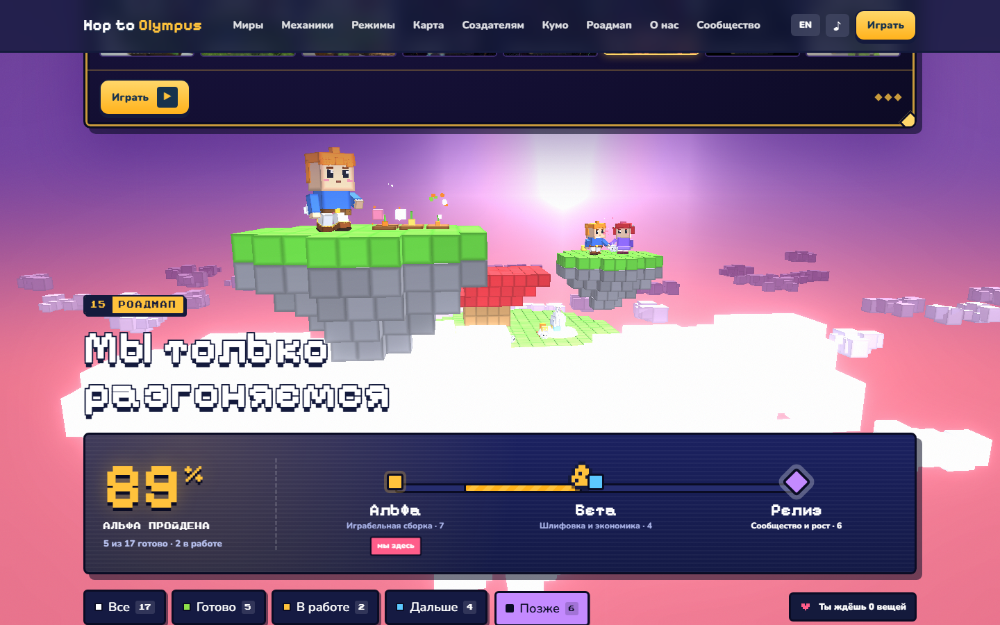 |

| Сетка вех | Английская версия |
|---|---|
| 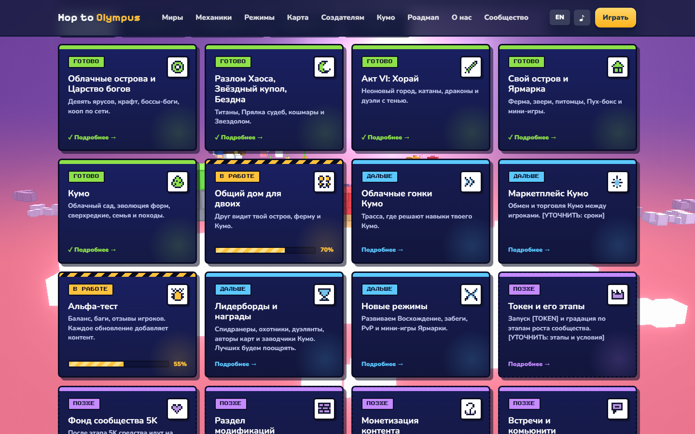 | 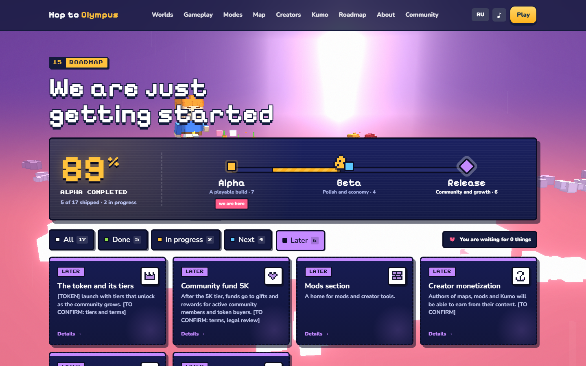 |

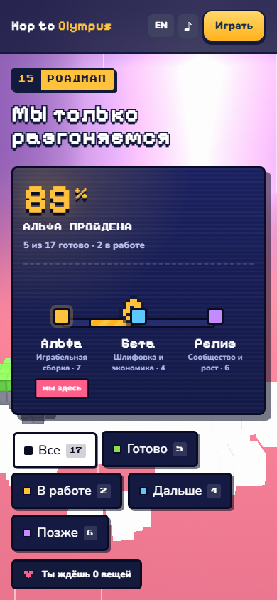

### Формат данных

Каждая веха в `roadmap.json`:

```json
{
  "id": "r6",
  "status": "progress",
  "icon": "duo",
  "pct": 70,
  "area":   { "ru": "Кооп", "en": "Co-op" },
  "title":  { "ru": "...", "en": "..." },
  "text":   { "ru": "краткое описание для плитки", "en": "..." },
  "detail": { "ru": "подробности для окна", "en": "..." }
}
```

| Поле | Значения |
|---|---|
| `status` | `done`, `progress`, `next`, `later` |
| `icon` | имя пиксель-иконки из `app.js`: `book bug cam chat clock crown dash duo egg eye glove heart hook house jump map moon portal pvp shield star sword tg trophy wall whale wings` |
| `pct` | нужен только у `progress`; без него считается 50 |
| `id` | уникален и стабилен: по нему хранится «Жду это», не меняй его у существующих пунктов |

> Значения `pct` (сейчас 70 и 55) — рабочие оценки. Поправь их под реальное состояние, когда оно изменится: процент в HUD пересчитается сам.

### Как сопоставлены статусы и фазы

| Фаза | Какие статусы входят |
|---|---|
| Альфа | `done`, `progress` |
| Бета | `next` |
| Релиз | `later` |

Добавить новую веху: дописать объект в `roadmap.json`, ничего больше менять не нужно.

## 5. Новый раздел «Кто мы»

Раньше это была обычная карточка с текстом и пустыми аватарами. Теперь раздел — «бейдж студии» с живыми числами и терминалом альфы.

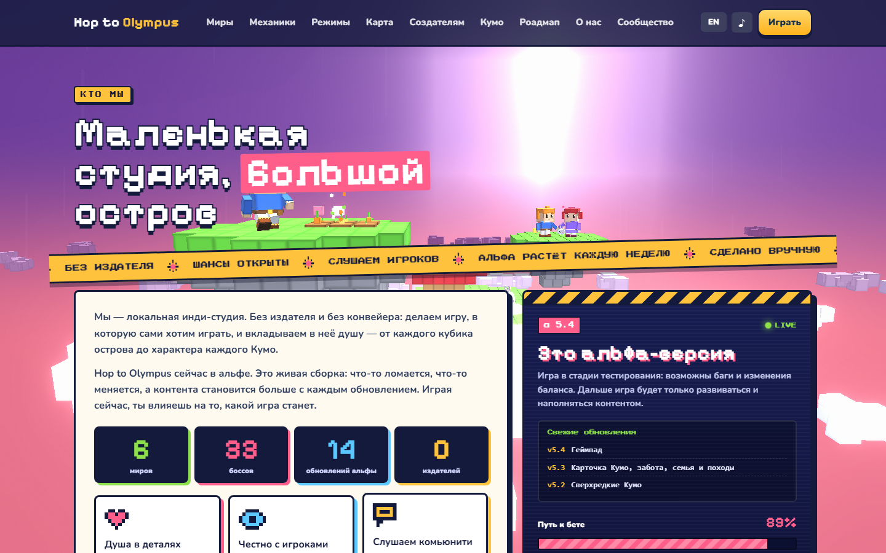

### Что внутри

- **Заголовок с маркером.** Слово «большой» выделено розовой плашкой, как будто его обвели маркером.
- **Жёлтая лента-манифест.** Бегущая строка с наклоном: «Сделано вручную · Без издателя · Шансы открыты · Слушаем игроков · Альфа растёт каждую неделю». Скрыта от скринридеров, чтобы не шуметь.
- **Живые цифры.** Четыре счётчика считают вверх, когда блок попадает в экран. Миры, боссы и обновления альфы берутся из данных (`worlds-all.json`, `bosses.json`, `patches.json`), поэтому растут сами. Четвёртый счётчик — «издателей: 0», это часть бренда.
- **Три переворачивающиеся карточки ценностей.** Душа в деталях, Честно с игроками, Слушаем комьюнити. Спереди короткая формулировка, на обороте обещание подробнее. Нажатие переворачивает карточку в 3D.
- **Команда.** Четыре пиксельных аватара-заглушки и кнопка «+ Ты?», которая прокручивает к блоку для создателей. Пометка `[УТОЧНИТЬ: состав команды, роли и фото]` оставлена, пока команда не подтверждена.
- **Терминал альфы.** Тёмная панель с жёлто-чёрной лентой, мигающим LIVE, номером текущей версии (`α 5.4`, берётся из первого патча), списком трёх свежих патчей, полосой «Путь к бете» (тот же процент, что в роадмапе) и кнопками «Играть» и «Патч-ноты».

| Карточки и терминал | Карточка перевёрнута |
|---|---|
| 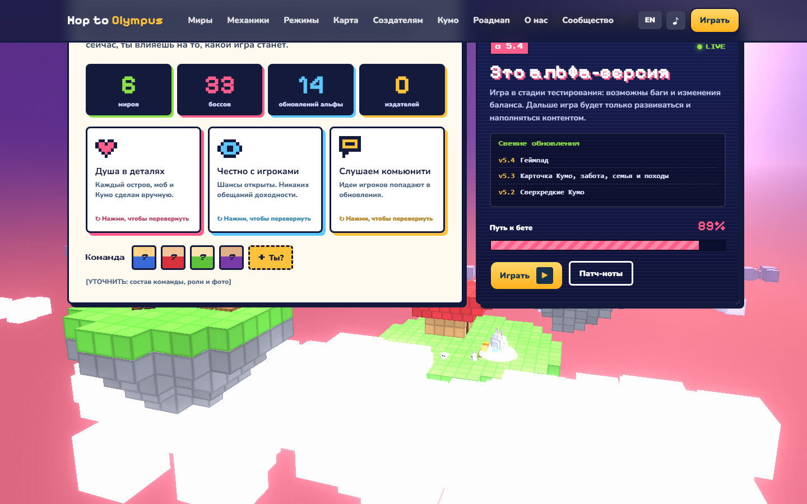 | 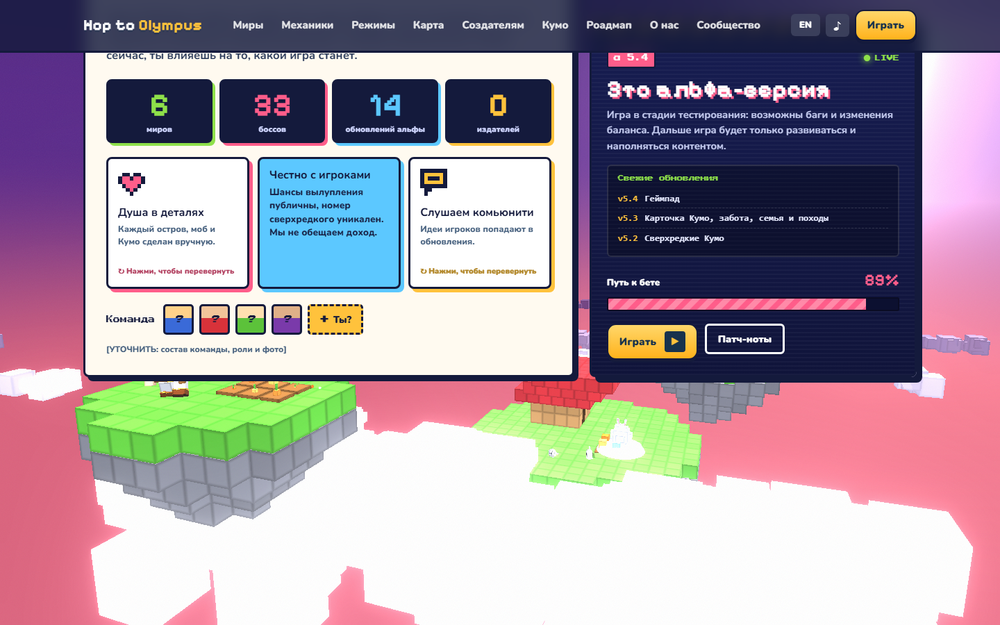 |

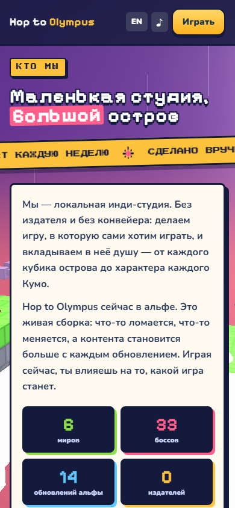

### Техническое

- Оба раздела рендерятся из `studio.js` в контейнеры `#roadApp` и `#aboutApp`. Скрытый `#roadList` оставлен, потому что старый код `app.js` его очищает и ожидает.
- Язык берётся из `<html lang>`. Переключатель RU/EN в шапке пересобирает разделы автоматически (через `MutationObserver`).
- Пиксельные иконки используют ту же функцию `pix`, что и остальной лендинг: `app.js` теперь отдаёт её как `window.HTO_PIX`.
- Учтён `prefers-reduced-motion`: анимации отключаются, значения показываются сразу.
- Все интерактивные элементы доступны с клавиатуры, у фокуса видимая рамка.

## 6. Механики игры

Шесть главных механик, как они описаны на лендинге ([mechanics.json](../landing/data/mechanics.json)).

### Прыгай всё выше
Ритмичные прыжки, крылья, рывки и крюк-кошка. Чем лучше ритм, тем выше полёт. 19 регионов вверх, три вида крыльев.
- Ритмичные прыжки: +5% скорости за прыжок в серии, пятый — мега-прыжок.
- Крылья трёх видов (Серафима, Гесперид, Ночные): полёт до трёх раз дольше.
- Крюк-кошка, двойное сальто сапог Гермеса, бег по стенам в таби Кагэ.

### Сражайся клинком
Мечи, катаны, косы и кулаки. Удар, удар, пауза — и выходит спецприём. 12 типов оружия, 4 паузных приёма.
- У каждого типа оружия свой строй ударов и особый третий удар.
- Паузные комбо: Цубамэ-гаэси, Сакура-ран, Райко, Каминари-гурума.
- Аниме-бой: столкновения клинков и идеальные уклонения, замедляющие время.

### Побеждай богов и титанов
Каждый акт заканчивается боссом из мифов, у которого свои фазы, арена и легендарная добыча. 33 босса, 7 глав.
- От Желейного короля до Крона, Рюджина и Геракла.
- У каждого босса фазы: Ламия зарывается под остров, Эмпуса мигает вокруг игрока.
- Легендарная добыча: Коса Крона, Лук Артемиды, Райкири.

### Куй снаряжение
Добыча с мобов превращается в броню, крылья и легендарное оружие. 32 предмета, 8 реликвий.
- Броня растёт: Черепаха → Теневое облачение → Доспех Эреба.
- Материалы падают с мобов: перья гарпий, ядра огненных духов, песок времени.
- Звездолом куётся только под Звёздным куполом, Мурамаса только в Хорае.

### Построй свой остров
Грядки, животные, питомцы и Ярмарка с мини-играми. Остров растёт вместе с игроком.
- Огород, рыбалка, кухня, мебель и lo-fi радио.
- Десять уровней уюта, питомцы и Облачный сад для Кумо.
- Портал Восхождения прямо на острове: 15-минутный рогалик.

### Играйте вместе
Онлайн-кооп: общие боссы, Пух-бокс на ринге и прогулки за руку. До 32 игроков в комнате, 8 режимов для двоих.


## 7. Техники движения и боя

Раздел «Техники» на лендинге показывает каждую в 3D-превью ([techniques.json](../landing/data/techniques.json), [techview.js](../landing/techview.js)).

| Техника | Суть |
|---|---|
| **Ритм-прыжки и банни-хоп** | Прыгай ровно в момент приземления: прыжки складываются в серию, каждый выше, скорость бега растёт на 5% за прыжок. Пятый — мега-прыжок. |
| **Рывок и двойной прыжок** | Рывок делает героя неуязвимым на мгновение: им проскальзывают сквозь атаки. Сапоги дают второй прыжок в воздухе с сальто. |
| **Бег по стенам** | Беги вдоль стены, не касаясь земли. В неоновом Хорае так срезают целые кварталы. |
| **Крюк-кошка** | Цепляйся за блоки, раскачивайся и запускай себя вверх. На часть островов без крюка не попасть. |
| **Крылья и полёт** | Зажми прыжок в воздухе, и герой летит. Три вида крыльев: золотые, ночные и Серафима, каждые держат дольше и поднимают выше. |
| **Паузные комбо** | Удар, удар, пауза, удар, и выходит спецприём. Мурамаса: Цубамэ-гаэси и Сакура-ран. Райкири: Райко и Каминари-гурума. |
| **PvP и отбрасывание** | PvP включается в любом мире. Удары отбрасывают, сильные приёмы дальше, а на ринге Пух-бокса побеждает тот, кто вытолкнет соперника. |
| **12 типов оружия** | Звёздный меч, катаны Мурамаса и Райкири, косы Гефеста и Крона, копьё, парные клинки, кулаки, жезл, лук, Ножницы Атропос и Звездолом. У каждого свой ритм. |

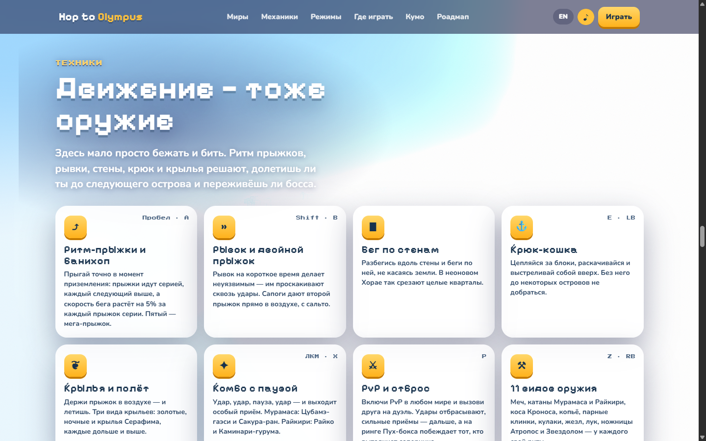

## 8. Режимы

Девять режимов ([modes.json](../landing/data/modes.json)).

| Режим | Что это |
|---|---|
| Шесть актов | От Облачных островов до Олимпа, Разлома Хаоса, Звёздного купола, Бездны и неонового Хорая. Боги, титаны, кошмары и драконы: 33 босса. |
| Вместе онлайн | Общие монстры и боссы: один ведёт бой, остальные видят то же самое. Добыча и опыт всем. Объятия, «дай пять», прогулки за руку. |
| Дуэли и ринг | PvP в любом мире с таблицей побед. На Ярмарке — Пух-бокс в надувных перчатках: лучший из трёх раундов, гонг и овечки-боты. |
| Восхождение | Портал на острове ведёт в забеги по случайным комнатам с модификаторами вроде низкой гравитации. Каждый раз новый маршрут. |
| Мастерская | Свои карты: старт, финиш, чекпоинты. Публикация, лайки, звёзды создателя, таблица рекордов каждой карты. |
| Гонки на время | Пять трасс с призраком лучшего забега и общими таблицами. Ритм-прыжки и рывки решают всё. |
| Арена героев | После Зевса начинается «Aftermath»: монстры злее, титаны первого мира просыпаются, Геракл приходит мстить. Арена бросает волны врагов. |
| Мини-игры | Пух-бокс, «Пол — это лава» и «Погоня за курицей» в одиночку или с другом, за билеты Ярмарки. |
| Свой остров | Ферма, куры и коровы, питомцы, заказы и десять уровней уюта. Остров растёт вместе с игроком. |

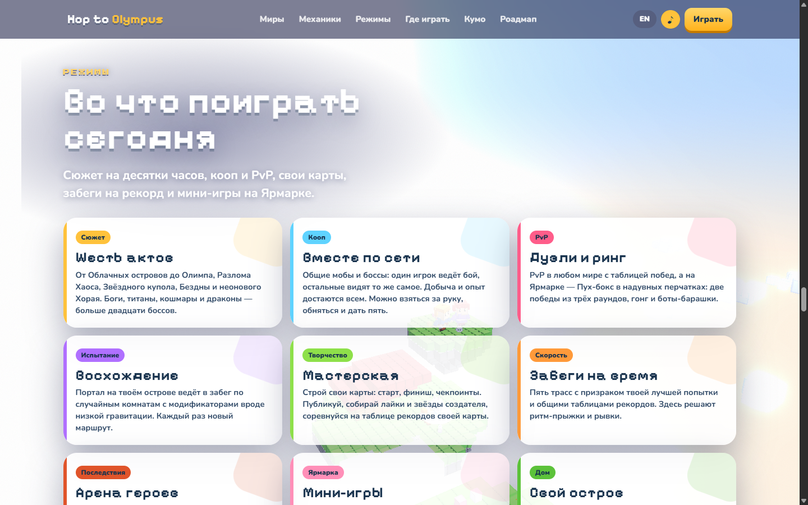

## 9. Миры и боссы

Шесть миров, одна вертикаль ([worlds-all.json](../landing/data/worlds-all.json), [map.json](../landing/data/map.json)). На лендинге есть настоящая 3D-карта мира, блок в блок: жёлтые флажки — телепорты, красные — боссы, фиолетовые — жители с заданиями.

| Мир | Суть |
|---|---|
| **Облачные острова** | Пять ярусов парящих островов, где учатся ритму и бою. |
| **Царство богов** | Сады Гесперид, Кузница Гефеста и Олимп, на вершине которого ждёт Зевс. |
| **Разлом Хаоса** | Тёмные ярусы за Олимпом: тени, стражи времени, ужасы Тартара, боссы Никта и Крон. |
| **Звёздный купол** | Небо над разломом: Прялка судеб, где куётся Звездолом. |
| **Бездна Эреба** | Перевёрнутый лес, кошмары и светящиеся грибы. Демонов Бездны режет только сталь Звездолома. |
| **Хорай** | Город тысячи фонарей: неон, катаны, драконы, дуэли с тенью. Подробно: [ARC_HORAI.md](ARC_HORAI.md). |

Боссов 33, они разбиты по актам. Для каждого в лендинге есть карточка с портретом, фазами и добычей ([bosses.json](../landing/data/bosses.json)). Скриншоты боссов лежат в [docs/screens](screens).


Лор вселенной, героев и конфликт между мирами: [LORE.md](LORE.md).

## 10. Кумо: питомцы, редкость, семья

Кумо — облачные питомцы. Они вылупляются из яиц в Облачном саду, эволюционируют, растут и ходят с игроком в походы. Подробные таблицы и версии: [CHANGELOG.md](../CHANGELOG.md), версии 5.2–5.4.


**Редкость.**
- Сверхредкий Кумо выпадает с шансом 1% при каждом вылуплении, в том числе после кокона перерождения.
- У каждого сверхредкого уникальный номер, он не повторяется.
- Внешний вид: кислотный неоновый градиент снизу вверх, у каждой формы свой, и радужное свечение под ним.

**Забота.**
- Сытость падает на 4% в час, настроение на 5% в час. Кумо не умирают, голодный или скучающий просто грустит.
- Искорка даёт +25% сытости, фрукт +15%. «Погладить» поднимает настроение на 20%, «подбросить» на 15%.

**Семья.** Два взрослых Кумо с настроением от 50% и сытостью от 40% приносят яйцо раз в сутки. Малыш получает фирменные детали родителей.

**Поход.** Любого вылупившегося Кумо можно взять с собой. Он ходит рядом во всех мирах, а клавиша `F` рядом с ним открывает способность: листопад, цепная молния, теневой шар, лисьи огоньки, звездопад, радужный луч. По врагам Хорая урон в 5 раз выше.

**Карточка Кумо.** Большое игровое окно: живой 3D-портрет на облачном подиуме, вкладки «Обзор», «Кормить», «Семья» и большие кнопки заботы.

**Честные шансы.** Раздел лендинга «Редкость без тумана» показывает симулятор вылупления.

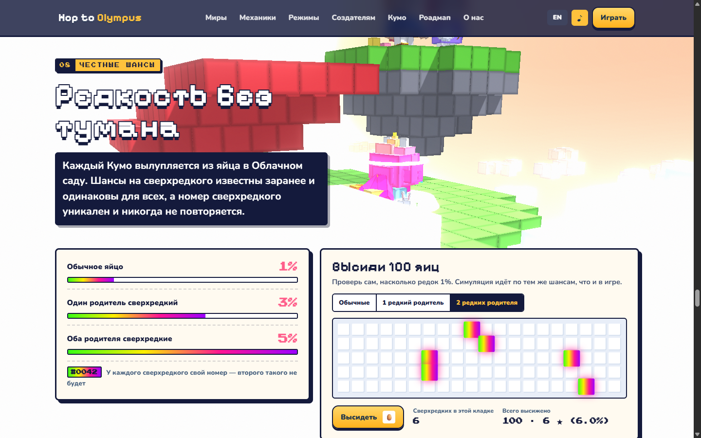

**Маркетплейс Кумо** (в планах). Обмен между игроками, у каждого Кумо номер и история. Сроки уточняются, подробнее в [роадмапе](#4-новый-роадмап-skyward-ascent).

## 11. Кооп, PvP и сеть

- **Общий мир по сети.** Игроки заходят на один сервер, и они в одном мире. Монстры и боссы общие: один игрок ведёт бой («липкий хозяин»), остальные видят то же самое.
- **Честная сеть.** К бою можно присоединиться в любой момент, смерть не откатывает бой, удары не теряются, подписи, звуки, туман и клоны зеркалятся, здоровье Каркинос и Эреба общее.
- **Добыча.** Лут и опыт получают все участники.
- **PvP.** Включается клавишей `P` в любом мире. Есть таблица побед.
- **Для двоих** восемь режимов: объятия, «дай пять», прогулки за руку, Пух-бокс, «Пол — это лава», «Погоня за курицей» и другие.
- **Общий дом** (в работе): друг видит твой остров, ферму и Кумо. Описание: [HOME_ISLAND.md](HOME_ISLAND.md).

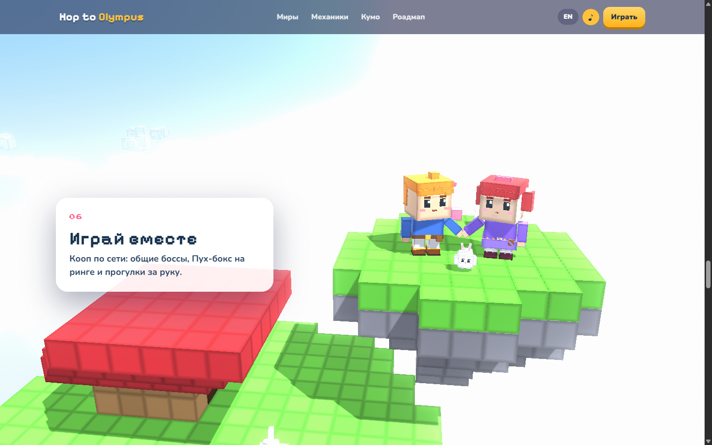

## 12. Мастерская и сообщество

Игроки строят свои карты в отдельной области неба. Основной мир сохраняется и возвращается после выхода. Полная инструкция: [WORKSHOP.md](WORKSHOP.md).

- Порядок: построить карту (старт, финиш, чекпоинты), пройти тест, опубликовать.
- Лайки и звёзды создателя: +1 за нового игрока, +2 за дошедшего до финиша, +5 за лайк. Свои прохождения не считаются.
- Карты можно передать кодом (`OBL1:…`) даже без сервера.
- Таблицы лидеров: достижения, мобы, PvP, создатели, гонки, у каждой карты своя.

Блок «Для создателей» и «Лидерборды» на лендинге показывают это вживую.

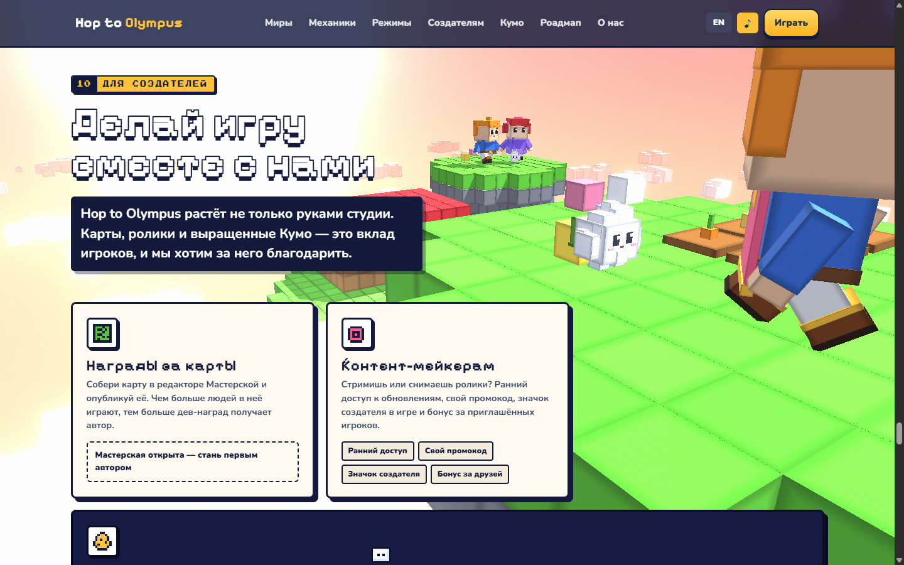

## 13. Управление

| Клавиша | Действие |
|---|---|
| WASD | бег (на любой раскладке) |
| Пробел | прыжок, в воздухе полёт на крыльях |
| Shift | рывок |
| ЛКМ / ПКМ | удар и копание / поставить блок |
| 1–9, Q, I | быстрые ячейки, выбросить, сумка |
| E | крюк-кошка |
| Z | сменить оружие |
| F | поговорить с NPC, способность Кумо |
| P | PvP вкл/выкл |
| C | крафт |
| G H J K L | эмоции |
| Enter | чат |
| B | редактор карты |
| N | карта мира |
| T | достижения и рекорды |
| O | настройки |

**Геймпад** (с версии 5.4): Xbox, PlayStation, Switch Pro и большинство USB/Bluetooth. **Телефон и планшет:** плавающий джойстик, кнопки прыжка, удара, рывка и крюка, щипок для приближения камеры.

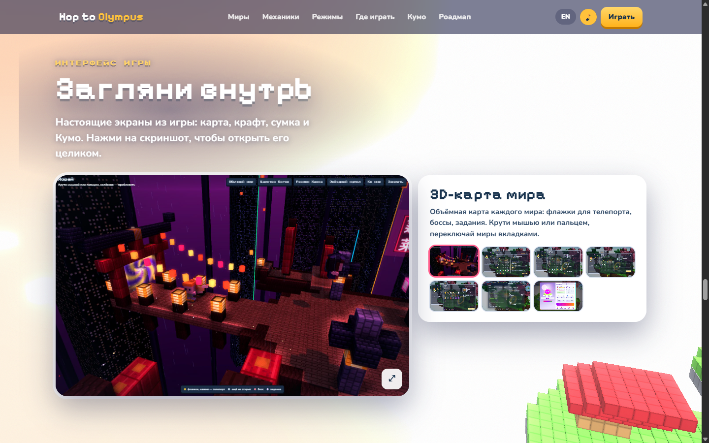

## 14. Запуск, деплой, проверка

### Локально

```bash
node server/server.js
# лендинг: http://localhost:8080/
# игра:    http://localhost:8080/play/
```

Нужен Node 18+. Зависимостей нет. Конфиги грузятся через `fetch`, поэтому страницу нужно открывать через сервер, а не двойным кликом.

### Git

Рабочая ветка `alpha-5.1-home-island`, remote `origin` = `https://github.com/chevdev1/SKYBLOCK.git`.

```bash
git add -A
git commit -m "Что изменилось"
git push origin alpha-5.1-home-island
```

### Vercel

Проект `oblaka` уже связан с папкой (`.vercel/`, она в `.gitignore`).

```bash
npx vercel deploy --prod --yes
```

В `vercel.json` лежат редирект `/play` → `/play/` и кэш `public, max-age=3600` для `/landing/*`. В `.vercelignore` исключены `server/`, `docs/`, `node_modules/`, логи и `play/index.dev.html`: сервер на Vercel не работает, он нужен только локально и на отдельном хостинге.

### Как проверить лендинг глазами

Скриншоты в этой документации сделаны скриптом на `playwright-core` и обычном Chrome с программным WebGL (`--use-gl=swiftshader`). Порядок такой: открыть страницу, подождать 3–4 секунды загрузки, прокрутить до секции, подождать 2 секунды анимации, сфотографировать. Для мобильной проверки окно 390×844.

Что проверяем перед выкладкой:
- в консоли нет ошибок;
- оба языка (кнопка EN/RU в шапке);
- роадмап: фильтры, окно вехи, «Жду это», стрелки ← →;
- «Кто мы»: счётчики считают, карточки переворачиваются;
- мобильная ширина без горизонтального скролла в этих разделах.

## 15. Как править контент

| Что поменять | Где |
|---|---|
| Вехи роадмапа | `landing/data/roadmap.json` |
| Патч-ноты | `landing/data/patches.json` (первая запись — текущая версия, её видно в терминале альфы) |
| Миры, боссы, оружие | `worlds*.json`, `bosses.json`, `arsenal.json` |
| Механики, техники, режимы | `mechanics.json`, `techniques.json`, `modes.json` |
| Тексты секций | словари `I18N.ru` / `I18N.en` в `app.js`; тексты разделов роадмапа и «Кто мы» в `T` внутри `studio.js` |
| Цвета, шрифты, радиусы | `landing/tokens.css` и `:root` в `style.css` |
| Состав команды | блок `ab-av` в `studio.js`, после подтверждения команды заменить заглушки на фото |

После любой правки данных ничего пересобирать не нужно: обнови страницу.

## 16. Принципы честности и тон текстов

- **Без обещаний дохода.** Про токен, фонд и монетизацию текст всегда содержит оговорку, что условия уточняются. Метки `[УТОЧНИТЬ]` и `[TO CONFIRM]` убирают только после подтверждения условий и юридической проверки.
- **Шансы открыты.** Любая случайная награда показывается с реальными шансами.
- **Никаких накрученных чисел.** Счётчики на лендинге считаются из данных; «Жду это» хранится только локально.
- **Тон.** Тёплый, прямой, без канцелярита. Пиксельный стиль, жирные тени и яркие цвета — часть бренда.

## 17. Что ещё впереди

Актуальный список всегда в роадмапе на лендинге. На момент написания:

- **В работе:** общий дом для двоих, альфа-тест (баланс, баги, отзывы).
- **Дальше:** облачные гонки Кумо, маркетплейс Кумо, лидерборды с наградами, новые режимы.
- **Позже:** токен и его этапы, фонд сообщества 5K, раздел модов, монетизация для создателей, встречи и турниры, Kickstarter.
